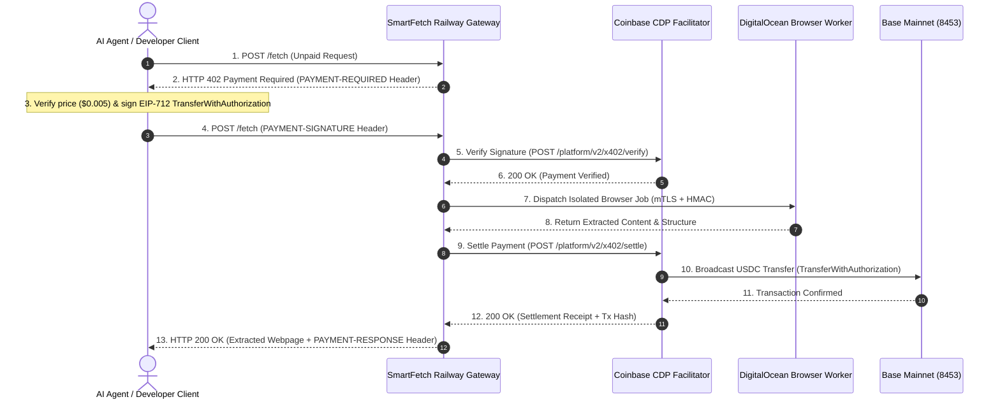

# SmartFetch AI Agent & Developer Payment Integration Guide

This guide provides developers and autonomous AI agents with complete, production-ready specifications and code examples for paying for SmartFetch browser retrievals using **x402 micropayments on Base Mainnet**.

---

## 1. Executive Summary & Parameters

SmartFetch uses the **x402 HTTP micropayment protocol** to monetize headless browser web retrieval. Clients pay **$0.005 USDC per successful extraction** using off-chain EIP-712 signatures (`TransferWithAuthorization`) settled on Base Mainnet by Coinbase Developer Platform (CDP) facilitators.

### Core Payment Parameters
| Parameter | Value | Description |
| :--- | :--- | :--- |
| **Protocol** | `x402` (Version 2) | Community HTTP micropayment standard |
| **Network** | `eip155:8453` | Base Mainnet |
| **Asset Contract** | `0x833589fCD6eDb6E08f4c7C32D4f71b54bdA02913` | Native USD Coin (USDC) on Base |
| **Price per Request** | `5000` atomic units ($0.005000 USD) | Decimals = 6 |
| **Seller Treasury (`payTo`)** | `0xE29Fcb6ef1534d5F138E48a8A71370BE7770A786` | SmartFetch production receiving wallet |
| **Payment Scheme** | `exact` | Canonical exact payment scheme |
| **Settlement Facilitator** | Coinbase Developer Platform (CDP) | Gas-free settlement for the buyer |

> [!NOTE]
> **Zero Gas for Buyers**: The buyer signs an off-chain EIP-712 message. The Coinbase CDP facilitator broadcasts the transaction to Base Mainnet and covers the transaction gas fee upon successful webpage retrieval.

---

## 2. End-to-End Execution Lifecycle

The x402 interaction lifecycle consists of 5 deterministic steps:



1. **Discovery**: Agent inspects `/.well-known/x402`, `/.well-known/agent-card.json`, or `/llms.txt` to learn endpoint pricing and parameters.
2. **Challenge (`402 Payment Required`)**: Client sends an unpaid request. The server returns HTTP 402 containing the `PAYMENT-REQUIRED` header describing exact network, token, amount, and recipient.
3. **Authorization Signing**: Client verifies the price does not exceed its maximum allowance (e.g. $0.005) and signs an EIP-712 `TransferWithAuthorization` using its private key or wallet signer.
4. **Execution (`POST /fetch` or `/mcp`)**: Client resubmits the request including the base64-encoded signature in the `PAYMENT-SIGNATURE` header.
5. **Settlement & Receipt**: SmartFetch verifies the authorization, renders the target website in an isolated headless Chromium worker, settles the payment on Base Mainnet, and returns HTTP 200 with the `PAYMENT-RESPONSE` header containing the on-chain transaction hash.

---

## 3. Python Integration Example

This production-ready Python script uses `httpx` and `eth-account` with the official `x402` SDK to execute an automated paid retrieval.

```bash
pip install httpx eth-account x402
```

```python
"""SmartFetch Python Paid Retrieval Client (Base Mainnet)."""

import os
from eth_account import Account
from x402 import x402ClientSync
from x402.http.clients import x402_requests
from x402.http.constants import PAYMENT_RESPONSE_HEADER, X_PAYMENT_RESPONSE_HEADER
from x402.http.utils import decode_payment_response_header
from x402.mechanisms.evm.exact import ExactEvmClientScheme
from x402.mechanisms.evm.signers import EthAccountSigner

SMARTFETCH_URL = "https://smartfetch-production-ea53.up.railway.app/fetch"
TARGET_URL = "https://example.com/"
BASE_MAINNET = "eip155:8453"
MAX_ALLOWANCE = "$0.005"  # Enforces half-cent safety cap


def fetch_paid_page(private_key: str, target_url: str = TARGET_URL) -> dict:
    """Execute an automated paid browser retrieval against SmartFetch."""
    account = Account.from_key(private_key)
    signer = EthAccountSigner(account)

    # Initialize guarded x402 client
    client = x402ClientSync()
    client.register(BASE_MAINNET, ExactEvmClientScheme(signer))
    client.set_spend_controls({"max_amount_per_payment": MAX_ALLOWANCE})

    # Wrap standard requests session with automatic 402 handling
    session = x402_requests(client=client)

    payload = {
        "url": target_url,
        "force_browser": True,  # Use headless Chromium rendering
        "max_chars": 20000,
    }

    print(f"Requesting {target_url} via SmartFetch...")
    response = session.post(SMARTFETCH_URL, json=payload, timeout=60)
    response.raise_for_status()

    # Extract on-chain settlement receipt
    raw_receipt = response.headers.get(PAYMENT_RESPONSE_HEADER) or response.headers.get(X_PAYMENT_RESPONSE_HEADER)
    settlement = decode_payment_response_header(raw_receipt) if raw_receipt else None

    result = response.json()
    print(f"Extraction Successful!")
    print(f"Page Title: {result.get('title')}")
    print(f"Word Count: {result.get('word_count')}")
    if settlement:
        print(f"Base Mainnet Tx: https://basescan.org/tx/{settlement.transaction}")

    return result


if __name__ == "__main__":
    key = os.getenv("BUYER_PRIVATE_KEY")
    if not key:
        raise ValueError("Set BUYER_PRIVATE_KEY environment variable to run.")
    fetch_paid_page(key)
```

---

## 4. TypeScript / Node.js Integration Example

This production-ready TypeScript script uses `viem` and `@x402/client` to execute an automated paid retrieval.

```bash
npm install viem @x402/core @x402/client
```

```typescript
import { privateKeyToAccount } from "viem/accounts";
import { x402Client, exactEvmScheme } from "@x402/client";

const SMARTFETCH_URL = "https://smartfetch-production-ea53.up.railway.app/fetch";
const BASE_MAINNET = "eip155:8453";
const MAX_ALLOWANCE = "$0.005";

async function fetchPaidWebpage(privateKey: `0x${string}`, targetUrl: string) {
  const account = privateKeyToAccount(privateKey);

  // Initialize x402 client with Base Mainnet signer
  const client = new x402Client();
  client.register(BASE_MAINNET, exactEvmScheme({ signer: account }));
  client.setSpendControls({ maxAmountPerPayment: MAX_ALLOWANCE });

  const payload = {
    url: targetUrl,
    force_browser: true,
    max_chars: 20000,
  };

  // 1. Initial unpaid request triggers HTTP 402 challenge
  const initialResponse = await fetch(SMARTFETCH_URL, {
    method: "POST",
    headers: { "Content-Type": "application/json" },
    body: JSON.stringify(payload),
  });

  if (initialResponse.status !== 402) {
    return await initialResponse.json();
  }

  // 2. Parse 402 requirements and sign EIP-712 authorization
  const challengeHeader = initialResponse.headers.get("payment-required");
  if (!challengeHeader) {
    throw new Error("Missing PAYMENT-REQUIRED header from SmartFetch");
  }

  const paymentAuth = await client.createPaymentAuthorization(challengeHeader);

  // 3. Resubmit request with PAYMENT-SIGNATURE
  const paidResponse = await fetch(SMARTFETCH_URL, {
    method: "POST",
    headers: {
      "Content-Type": "application/json",
      "payment-signature": paymentAuth.signatureHeader,
    },
    body: JSON.stringify(payload),
  });

  if (!paidResponse.ok) {
    throw new Error(`SmartFetch failed with status ${paidResponse.status}: ${await paidResponse.text()}`);
  }

  const receiptHeader = paidResponse.headers.get("payment-response");
  const data = await paidResponse.json();

  console.log("Extraction Succeeded:", data.title);
  if (receiptHeader) {
    const receipt = JSON.parse(Buffer.from(receiptHeader, "base64").toString("utf-8"));
    console.log(`Base Mainnet Tx: https://basescan.org/tx/${receipt.transaction}`);
  }

  return data;
}
```

---

## 5. Model Context Protocol (MCP) Integration

SmartFetch exposes standard Model Context Protocol (MCP) tools over **Streamable HTTP transport** at:
`https://smartfetch-production-ea53.up.railway.app/mcp`

### Available Tools
1. `fetch_webpage`: Complete browser extraction with HTML, clean text, metadata, and links.
2. `webpage_to_markdown`: Clean Markdown conversion optimized for LLM context windows.
3. `extract_webpage_text`: High-density plain text extraction without markup noise.
4. `render_webpage`: Guaranteed headless Chromium execution for Single-Page Applications (SPAs).

### Paying MCP Client Configuration
When using MCP clients (such as Claude Desktop, Cursor, or custom agent runners), configure the client session with payment support:

```python
from mcp import ClientSession
from mcp.client.streamable_http import streamable_http_client
from x402.mcp import x402MCPSession

async def run_mcp_agent():
    async with streamable_http_client("https://smartfetch-production-ea53.up.railway.app/mcp") as (read, write):
        # x402MCPSession automatically injects PAYMENT-SIGNATURE on tool calls
        async with x402MCPSession(read, write, payment_client=payment_client) as session:
            await session.initialize()
            
            # List tools (free, cached)
            tools = await session.list_tools()
            
            # Call tool (triggers verified $0.005 USDC payment)
            result = await session.call_tool("webpage_to_markdown", {"url": "https://news.ycombinator.com"})
            print(result.content[0].text)
```

---

## 6. Manifest & Registry Discovery Endpoints

SmartFetch provides machine-readable discovery endpoints conforming to emerging AI agent standards:

| Endpoint | Standard | Purpose |
| :--- | :--- | :--- |
| `/.well-known/x402` | x402 Manifest v2 | Machine-readable pricing, asset address, and payment schemes |
| `/.well-known/agent-card.json` | A2A Protocol | Agent-to-Agent discovery card (capabilities, transport, contact) |
| `/.well-known/owners.json` | VerifyMCP Standard | Verified domain and MCP identity proof |
| `/openapi.json` | OpenAPI 3.1 | REST API specification for programmatic tooling |
| `/llms.txt` | LLMs.txt Standard | LLM-readable summary and developer reference |
| `/health` | Production Health | Service status and browser worker availability indicator |

---

## 7. Troubleshooting & FAQ

### Q: Why did my request return `422 Unprocessable Entity`?
A: You sent an empty or malformed JSON body. Ensure you send a JSON payload containing at least `{"url": "https://..."}`.

### Q: Why did my request return `405 Method Not Allowed`?
A: Retrieval requests to `/fetch` must use `POST`. `GET` is not allowed on retrieval endpoints.

### Q: Is there any minimum wallet balance required?
A: Yes. The buyer wallet must hold at least **0.005 USDC** on **Base Mainnet**. You do not need ETH for gas; Coinbase CDP pays the transaction gas.

### Q: What happens if the target webpage fails to render?
A: SmartFetch enforces **fair exchange**: payment is settled only if webpage extraction succeeds. If retrieval fails with an error status (4xx or 5xx), the payment authorization is discarded and no on-chain transaction is broadcast.
