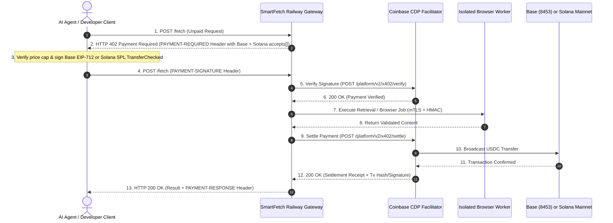

# SmartFetch AI Agent & Developer Payment Integration Guide

This guide provides developers and autonomous AI agents with complete, production-ready specifications and code examples for paying for SmartFetch web retrievals, screenshots, site inspections, and parallel batch fetches using **x402 v2 micropayments** on **Base Mainnet** or **Solana Mainnet**.

---

## 1. Executive Summary & Dual-Chain Parameters

SmartFetch uses the **x402 HTTP micropayment protocol (v2)** across all 4 REST endpoints and 7 MCP tools. Every `402 Payment Required` challenge includes `accepts[]` entries for both **Base Mainnet USDC** (EVM EIP-712 `TransferWithAuthorization`) and **Solana Mainnet USDC** (SVM SPL `TransferChecked`), settled by Coinbase Developer Platform (CDP) facilitators.

### Core Payment Parameters

| Parameter | Base Mainnet (EVM) | Solana Mainnet (SVM) |
| :--- | :--- | :--- |
| **Protocol / Scheme** | `x402` v2 / `exact` | `x402` v2 / `exact` |
| **CAIP-2 Network** | `eip155:8453` | `solana:5eykt4UsFv8P8NJdTREpY1vzqKqZKvdp` |
| **USDC Asset** | `0x833589fCD6eDb6E08f4c7C32D4f71b54bdA02913` | `EPjFWdd5AufqSSqeM2qN1xzybapC8G4wEGGkZwyTDt1v` |
| **Seller (`payTo`)** | `0xE29Fcb6ef1534d5F138E48a8A71370BE7770A786` | `88hE4EB4yZwb4F2arPXcG7efwQyU5FDN26DuVpVKVk2W` |
| **Facilitator / Fee Payer** | Coinbase CDP (pays Base gas) | Coinbase CDP (`feePayer`: `BENrLoUbndxoNMUS5JXApGMtNykLjFXXixMtpDwDR9SP`) |

### Endpoint & Tool Pricing

| REST Endpoint | MCP Tool(s) | Price (USDC) | Atomic Units (6 decimals) |
| :--- | :--- | :--- | :--- |
| `POST /fetch` | `fetch_webpage`, `webpage_to_markdown`, `extract_webpage_text`, `render_webpage` | **$0.005** | `5000` |
| `POST /inspect` | `inspect_webpage` | **$0.005** | `5000` |
| `POST /screenshot` | `screenshot_webpage` | **$0.010** | `10000` |
| `POST /batch-fetch` | `batch_fetch_webpages` | **$0.015** | `15000` |

> [!NOTE]
> **Zero Gas / Native Token Required for Buyers**: On Base Mainnet, the buyer signs an off-chain EIP-712 message and CDP covers ETH gas. On Solana Mainnet, the buyer co-signs an SPL `TransferChecked` transaction where CDP's `feePayer` covers the SOL transaction fee.

---

## 2. End-to-End Execution Lifecycle



---

## 3. Python Integration — Base Mainnet (EVM)

For a ready-to-run interactive script with hidden key prompt and strict spend controls, see [`scripts/paid_fetch_mainnet_test.py`](../scripts/paid_fetch_mainnet_test.py).

```bash
pip install "x402[evm]==2.20.0" eth-account
```

```python
"""SmartFetch Python Paid Retrieval Client (Base Mainnet)."""

import getpass
from eth_account import Account
from x402 import x402ClientSync
from x402.http.clients import x402_requests
from x402.http.constants import PAYMENT_RESPONSE_HEADER, X_PAYMENT_RESPONSE_HEADER
from x402.http.utils import decode_payment_response_header
from x402.mechanisms.evm.exact import ExactEvmClientScheme
from x402.mechanisms.evm.signers import EthAccountSigner

SMARTFETCH_URL = "https://smartfetch-production-ea53.up.railway.app/fetch"
BASE_MAINNET = "eip155:8453"
MAX_ALLOWANCE = "$0.005"


def fetch_paid_base(target_url: str = "https://example.com/") -> dict:
    private_key = getpass.getpass("Buyer EVM private key: ")
    account = Account.from_key(private_key)
    private_key = None

    client = x402ClientSync()
    client.register(BASE_MAINNET, ExactEvmClientScheme(EthAccountSigner(account)))
    client.set_spend_controls({"max_amount_per_payment": MAX_ALLOWANCE})

    with x402_requests(client=client) as session:
        response = session.post(
            SMARTFETCH_URL,
            json={"url": target_url, "max_chars": 20000},
            timeout=60,
        )
        response.raise_for_status()
        raw_receipt = (
            response.headers.get(PAYMENT_RESPONSE_HEADER)
            or response.headers.get(X_PAYMENT_RESPONSE_HEADER)
        )
        if raw_receipt:
            settlement = decode_payment_response_header(raw_receipt)
            print(f"Settled on {settlement.network}: {settlement.transaction}")
        return response.json()
```

---

## 4. Python Integration — Solana Mainnet (SVM)

For a ready-to-run interactive script with hidden key prompt and strict spend controls, see [`scripts/paid_fetch_solana_mainnet_test.py`](../scripts/paid_fetch_solana_mainnet_test.py).

```bash
pip install "x402[svm]==2.20.0" "solana==0.36.12" "solders==0.27.1"
```

```python
"""SmartFetch Python Paid Retrieval Client (Solana Mainnet)."""

import getpass
from solders.keypair import Keypair
from x402 import x402ClientSync
from x402.http.clients import x402_requests
from x402.http.constants import PAYMENT_RESPONSE_HEADER, X_PAYMENT_RESPONSE_HEADER
from x402.http.utils import decode_payment_response_header
from x402.mechanisms.svm.exact import ExactSvmClientScheme
from x402.mechanisms.svm.signers import KeypairSigner

SMARTFETCH_URL = "https://smartfetch-production-ea53.up.railway.app/fetch"
SOLANA_MAINNET = "solana:5eykt4UsFv8P8NJdTREpY1vzqKqZKvdp"
MAX_ALLOWANCE = "$0.005"


def fetch_paid_solana(target_url: str = "https://example.com/") -> dict:
    secret_key = getpass.getpass("Buyer Solana secret key (base58): ")
    keypair = Keypair.from_base58_string(secret_key.strip())
    secret_key = None

    client = x402ClientSync()
    client.register(SOLANA_MAINNET, ExactSvmClientScheme(KeypairSigner(keypair)))
    client.set_spend_controls({"max_amount_per_payment": MAX_ALLOWANCE})

    with x402_requests(client=client) as session:
        response = session.post(
            SMARTFETCH_URL,
            json={"url": target_url, "max_chars": 20000},
            timeout=60,
        )
        response.raise_for_status()
        raw_receipt = (
            response.headers.get(PAYMENT_RESPONSE_HEADER)
            or response.headers.get(X_PAYMENT_RESPONSE_HEADER)
        )
        if raw_receipt:
            settlement = decode_payment_response_header(raw_receipt)
            print(f"Settled on {settlement.network}: https://solscan.io/tx/{settlement.transaction}")
        return response.json()
```

---

## 5. TypeScript / Node.js Integration Example

```bash
npm install viem @x402/core @x402/client
```

```typescript
import { privateKeyToAccount } from "viem/accounts";
import { x402Client, exactEvmScheme } from "@x402/client";

const SMARTFETCH_URL = "https://smartfetch-production-ea53.up.railway.app/fetch";
const BASE_MAINNET = "eip155:8453";
const MAX_ALLOWANCE = "$0.005";

async function fetchPaidWebpage(privateKey: `0x${string}`, targetUrl: string) {
  const account = privateKeyToAccount(privateKey);

  const client = new x402Client();
  client.register(BASE_MAINNET, exactEvmScheme({ signer: account }));
  client.setSpendControls({ maxAmountPerPayment: MAX_ALLOWANCE });

  const payload = { url: targetUrl, force_browser: false, max_chars: 20000 };

  const initialResponse = await fetch(SMARTFETCH_URL, {
    method: "POST",
    headers: { "Content-Type": "application/json" },
    body: JSON.stringify(payload),
  });

  if (initialResponse.status !== 402) {
    return await initialResponse.json();
  }

  const challengeHeader = initialResponse.headers.get("payment-required");
  if (!challengeHeader) {
    throw new Error("Missing PAYMENT-REQUIRED header from SmartFetch");
  }

  const paymentAuth = await client.createPaymentAuthorization(challengeHeader);

  const paidResponse = await fetch(SMARTFETCH_URL, {
    method: "POST",
    headers: {
      "Content-Type": "application/json",
      "payment-signature": paymentAuth.signatureHeader,
    },
    body: JSON.stringify(payload),
  });

  if (!paidResponse.ok) {
    throw new Error(`SmartFetch failed with status ${paidResponse.status}`);
  }

  return await paidResponse.json();
}
```

---

## 6. Model Context Protocol (MCP) Integration

SmartFetch exposes 7 MCP tools over **Streamable HTTP transport** at:
`https://smartfetch-production-ea53.up.railway.app/mcp`

1. `fetch_webpage` ($0.005): Primary webpage and PDF retrieval tool with automatic browser fallback.
2. `webpage_to_markdown` ($0.005): Clean Markdown and core metadata converter.
3. `extract_webpage_text` ($0.005): Clean plain-text and core metadata extractor.
4. `render_webpage` ($0.005): Forced headless Chromium browser renderer returning post-JS DOM.
5. `screenshot_webpage` ($0.010): Isolated Chromium screenshot capture (desktop/mobile, JPEG/PNG).
6. `inspect_webpage` ($0.005): Structured site intelligence (metadata, OG, JSON-LD, contacts, tech stack, security headers).
7. `batch_fetch_webpages` ($0.015): Parallel retrieval of up to 5 URLs concurrently with fair settlement.

See [`examples/README.md`](../examples/README.md) for runnable Python and TypeScript MCP client examples.

---

## 7. Security & Fair-Exchange Guarantees

- **Fair Exchange**: SmartFetch verifies payment authorization before execution and settles **only** after a valid `200 OK` result is produced. Upstream `4xx`/`5xx` failures never settle payment.
- **Secret Safety**: Never place a private key or recovery phrase in a URL, request body, log, example, command-line argument, or repository file. Never commit secret-bearing `.env` files. Use hidden interactive input, a platform-injected secret, or an approved wallet/secret-management service.
