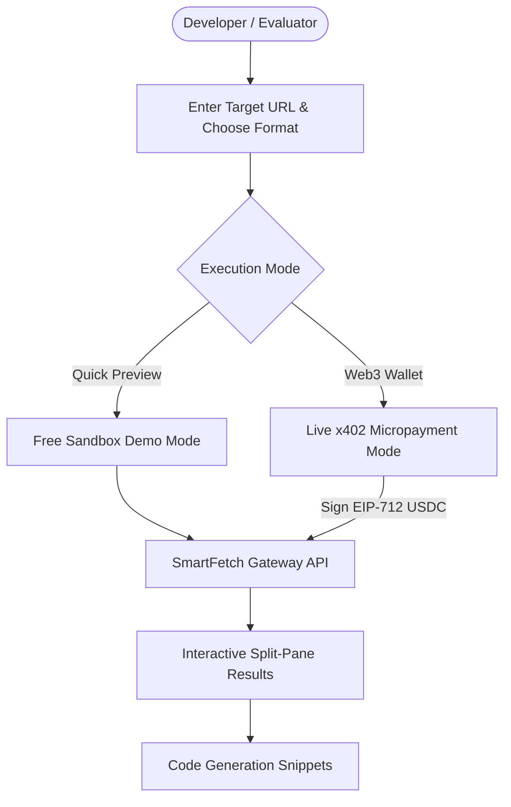
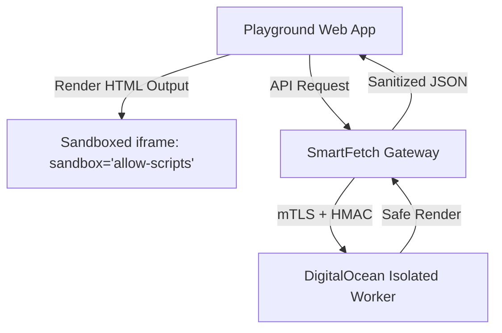

# SmartFetch Interactive Playground: Architecture & Design Plan

**Document Status**: Design & Architecture Plan (Non-Production / Roadmap)  
**Target Milestone**: Post-v1.12.0 Feature Planning  
**Scope**: Interactive demonstration, client code generation, and optional on-chain x402 payment testing interface.

---

## 1. Executive Summary & Objective

The **SmartFetch Playground** is a planned lightweight, browser-based demonstration and testing application. It allows developers, evaluators, and AI agent creators to:
1. Input any public URL and visually observe SmartFetch's browser retrieval in real-time.
2. Toggle extraction views between **Clean Markdown**, **Extracted Plain Text**, **Raw HTML**, and **Page Metadata**.
3. Optionally connect an EVM wallet (e.g. MetaMask, Coinbase Wallet) to experience the live **Base Mainnet x402 micropayment** flow ($0.005 USDC) interactively.
4. Auto-generate copy-pasteable **Python**, **TypeScript**, and **cURL** client code with embedded payment authorization snippets.

---

## 2. Core Architectural Evaluation

### 2.1 Repository Placement: Subdirectory vs. Separate Repository

| Dimension | Option A: Monorepo Subfolder (`/playground`) | Option B: Separate Repository (`smartfetch-playground`) |
| :--- | :--- | :--- |
| **Dependency Isolation** | Moderate (mixes Node/React dependencies with Python backend) | **High (Clean separation; core backend remains purely Python)** |
| **CI / Test Velocity** | Slower (Playwright/Jest tests added to core CI pipeline) | **Fast (Core API releases and test suites remain untouched)** |
| **Deployment Decoupling** | Tied to Railway gateway rebuilds | **Decoupled (Can deploy to Vercel/Cloudflare Pages independently)** |
| **Security Footprint** | Frontend bundle served from same origin as API gateway | **High (Cross-origin separation protects API gateway tokens/cookies)** |
| **Recommendation** | Acceptable for minimal static HTML | **STRONGLY RECOMMENDED for a full SPA application** |

**Architectural Decision**: 
- For an initial lightweight developer demo, a static single-file HTML preview tool can be maintained in `examples/playground/index.html`.
- For the full production-grade public web playground, a **separate repository** (`smartfetch-playground`) hosted on **Cloudflare Pages** or **Vercel** communicating via standard CORS with `https://smartfetch-production-ea53.up.railway.app` is the recommended design.

---

## 3. Playground User Flow & Features

### 3.1 Feature Specifications

1. **URL Input & Extraction Options**:
   - URL field with auto-validation and protocol normalization (`https://`).
   - Format selector tabs:
     - `Markdown` (formatted rendering via markdown parser)
     - `Plain Text` (clean extracted prose)
     - `Raw DOM` (syntax-highlighted HTML)
     - `Metadata Inspector` (Title, description, open-graph tags, canonical URL, word count)
   - Configuration toggles: `force_browser` (headless Chromium vs. fast HTTP), `max_chars` slider (1,000 to 50,000).

2. **Payment Mode Selection**:
   - **Mode A: Live x402 Web3 Wallet**:
     - Connect via standard injected EVM provider (MetaMask, Coinbase Wallet, Rainbow).
     - Checks Base Mainnet USDC balance.
     - Triggers standard `eth_signTypedData_v4` prompt for the exact $0.005 authorization.
     - Displays live BaseScan transaction link upon settlement.
   - **Mode B: Interactive Developer Sandbox (Sponsored)**:
     - Allows 3 free preview extractions per session with capped sample URLs (e.g. documentation sites, news sites) using a rate-limited playground proxy key.

3. **Code Generation Panel**:
   - As the user changes URL or format parameters, the right-hand panel dynamically updates with runnable code in:
     - Python (`httpx` + `x402`)
     - TypeScript (`viem` + `fetch`)
     - cURL (`POST /fetch`)
     - MCP Client Configuration (`claude_desktop_config.json`)

---

## 4. Security & Safety Architecture

Deploying an interactive web interface that fetches arbitrary external web content requires strict security boundaries:

1. **Iframe Sandboxing for HTML Previews**:
   - Rendered HTML must never be injected directly into the main playground DOM.
   - Must use an isolated `<iframe>` with strict sandbox attributes:
     `sandbox="allow-scripts"` (without `allow-same-origin` or `allow-top-navigation`).
   - Content-Security-Policy (CSP) headers must prevent cookie leakage and clickjacking.

2. **CORS Policy on Railway Gateway**:
   - SmartFetch gateway currently allows cross-origin requests.
   - The playground should communicate strictly via standard CORS headers without credentials or shared cookies.

3. **SSRF & Malicious Input Defense**:
   - SmartFetch's core defense-in-depth architecture already protects against SSRF (private IPs, `169.254.169.254`, loopback addresses are blocked by the DigitalOcean Unix policy broker).
   - The playground will include client-side schema validation preventing internal host lookups before requests are dispatched.

---

## 5. Hosting & Implementation Roadmap

### Phase 1: Prototype / Static Example (Immediate Horizon)
- Maintain a single, self-contained demonstration file in `examples/playground/index.html` that developers can run locally using `python -m http.server`.
- Uses mock or client-provided MetaMask signing.

### Phase 2: Standalone Web Application (Future Horizon)
- Framework: Next.js / React with Tailwind CSS and `viem` / `wagmi`.
- Hosting: Cloudflare Pages or Vercel with automatic edge caching.
- Domain: `playground.smartfetch.dev` or `smartfetch.dev`.
- Analytics: Privacy-preserving edge metrics measuring tool conversion rates.
