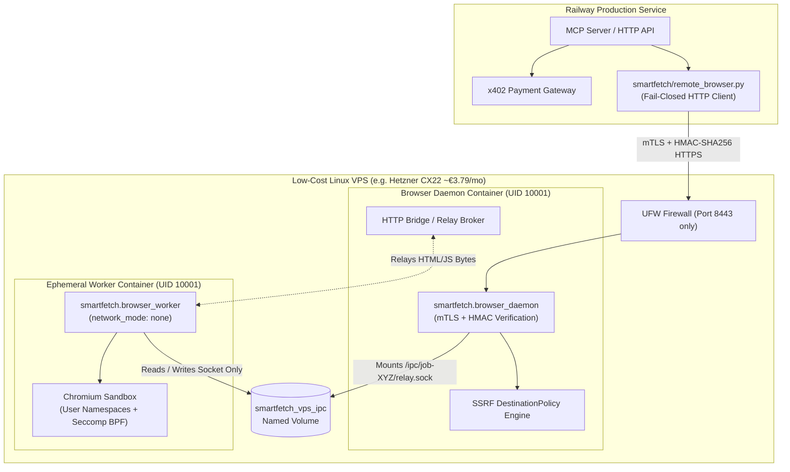

# SmartFetch VPS Browser Worker Deployment & Operations Guide

This guide documents the production deployment, packaging, security architecture, and operational runbook for the isolated SmartFetch browser worker daemon running on an unprivileged, low-cost Linux VPS.

---

## 1. System Architecture & Topology

SmartFetch uses a split-tier architecture to decouple the public-facing API and payment gateway from untrusted headless browser execution.



### Security Invariants & Defense-in-Depth
1. **Network Isolation**: The browser worker container runs with `--network none`. It has zero socket interfaces except the mounted UNIX domain socket `/ipc/<job_id>/relay.sock`.
2. **SSRF Filtering**: The daemon enforces `DestinationPolicy` using OS DNS resolution and IP classification before initiating any connection. Loopback (`127.0.0.0/8`), private networks (`10.0.0.0/8`, `172.16.0.0/12`, `192.168.0.0/16`), link-local (`169.254.0.0/16`), and multicast addresses are rejected with `policy_rejection`.
3. **Chromium Sandboxing**: Chromium runs without `--no-sandbox`. Unprivileged user namespaces sandboxing (`--disable-setuid-sandbox`) is enabled, accompanied by a custom Seccomp BPF profile filtering dangerous system calls.
4. **Non-Root Execution**: Both the daemon and worker run under dedicated unprivileged UID/GID `10001:10001`.
5. **Strict Environment Sanitization**: The worker entrypoint executes `exec env -i`, passing only a strict 6-variable allowlist (`PATH`, `HOME`, `TMPDIR`, `LANG`, `LC_ALL`, `PYTHONDONTWRITEBYTECODE`).
6. **Double Authentication**: All requests require both TLS client certificate validation (mTLS) and an HMAC-SHA256 signature calculated over `METHOD\nPATH\nTIMESTAMP\nNONCE\nBODY_SHA256`. Replay attacks are rejected beyond a 300-second window.

---

## 2. VPS Hardware & Provider Recommendations

Rendering headless Chromium pages consumes roughly 0.5–1.0 vCPU and 350–700 MB RAM per active tab.

| Provider | Instance Type | vCPU | RAM | NVMe SSD | Monthly Cost | Max Concurrency |
| :--- | :--- | :--- | :--- | :--- | :--- | :--- |
| **Hetzner Cloud** (Recommended) | CX22 | 2 vCPU | 4 GB | 40 GB | ~€3.79/mo | 4 concurrent |
| **Hetzner Cloud** (High Volume) | CPX31 | 4 vCPU | 8 GB | 160 GB | ~€10.50/mo | 8 concurrent |
| **DigitalOcean** | Basic Droplet | 2 vCPU | 4 GB | 80 GB | ~$24.00/mo | 4 concurrent |
| **Linode / Akamai** | Shared Linode | 2 vCPU | 4 GB | 80 GB | ~$24.00/mo | 4 concurrent |
| **Scaleway** | DEV1-L | 3 vCPU | 4 GB | 40 GB | ~€6.50/mo | 4 concurrent |

**Operating System**: Debian 12 (Bookworm) 64-bit or Ubuntu 24.04 LTS.

---

## 3. Provisioning Walkthrough

### Option A: Automated Provisioning (Fastest)

1. Provision a fresh Debian 12 or Ubuntu 24.04 VPS.
2. SSH into the server as root:
   ```bash
   ssh root@<vps-ip-address>
   ```
3. Clone the SmartFetch repository to `/opt/smartfetch`:
   ```bash
   git clone -b codex/railway-browser-isolation-prototype https://github.com/<org>/smartfetch.git /opt/smartfetch
   cd /opt/smartfetch
   ```
4. Run the automated setup script, providing your VPS domain or static IP:
   ```bash
   sudo bash scripts/setup_vps.sh worker.yourdomain.com
   ```
5. The setup script will:
   - Install Docker Engine, Docker Compose, and UFW.
   - Configure unprivileged user namespaces in `/etc/sysctl.d/99-smartfetch-userns.conf`.
   - Open ports `22` (SSH) and `8443` (daemon mTLS).
   - Create Docker volume `smartfetch_vps_ipc` owned by `10001:10001`.
   - Generate private CA and mTLS certificates in `/opt/smartfetch/deploy/vps/certs`.
   - Generate production `.env` with a 32-byte cryptographic HMAC secret.
   - Build production Docker images (`smartfetch-browser-worker:prod`, `smartfetch-browser-daemon:prod`).
   - Install, enable, and start the `smartfetch-daemon.service` systemd unit.

---

### Option B: Manual Step-by-Step Provisioning

#### Step 1: Kernel Configuration
Debian kernels require enabling unprivileged user namespaces:
```bash
echo "kernel.unprivileged_userns_clone=1" > /etc/sysctl.d/99-smartfetch-userns.conf
echo "user.max_user_namespaces=28633" > /etc/sysctl.d/99-smartfetch-limits.conf
sysctl --system
```

#### Step 2: Firewall Setup
```bash
ufw default deny incoming
ufw default allow outgoing
ufw allow 22/tcp comment "SSH"
ufw allow 8443/tcp comment "Browser Daemon"
ufw --force enable
```

#### Step 3: Service User & Directory Tree
```bash
groupadd --gid 10001 smartfetch 2>/dev/null || true
useradd --uid 10001 --gid 10001 --create-home --home-dir /home/smartfetch --shell /bin/false smartfetch 2>/dev/null || true

mkdir -p /opt/smartfetch/deploy/vps/certs
docker volume create smartfetch_vps_ipc
docker run --rm -v smartfetch_vps_ipc:/ipc debian:stable-slim chown -R 10001:10001 /ipc
```

#### Step 4: Generate mTLS Certificates
```bash
bash scripts/generate_mtls_certs.sh /opt/smartfetch/deploy/vps/certs worker.yourdomain.com
```

#### Step 5: Environment File
Create `/opt/smartfetch/.env` based on `/opt/smartfetch/deploy/vps/vps.env.example`:
```bash
cp deploy/vps/vps.env.example /opt/smartfetch/.env
# Replace HMAC key with a fresh random 32-byte secret:
sed -i "s/replace_with_64_character_hex_secret_generated_by_openssl/$(openssl rand -hex 32)/" /opt/smartfetch/.env
# Set DOCKER_GID
DOCKER_GID=$(getent group docker | cut -d: -f3)
echo "DOCKER_GID=${DOCKER_GID}" >> /opt/smartfetch/.env
chmod 0600 /opt/smartfetch/.env
```

#### Step 6: Build & Launch
```bash
docker compose -f deploy/vps/docker-compose.vps.yml build
cp deploy/vps/systemd/smartfetch-daemon.service /etc/systemd/system/
systemctl daemon-reload
systemctl enable --now smartfetch-daemon.service
```

---

## 4. Environment Variables Reference

### VPS Browser Daemon (`/opt/smartfetch/.env`)

| Variable | Required | Default | Description |
| :--- | :--- | :--- | :--- |
| `BROWSER_WORKER_HMAC_KEY` | **Yes** | *None* | 64-char hex secret (32 bytes) for HMAC-SHA256 signature verification. |
| `BROWSER_WORKER_HOST` | No | `0.0.0.0` | Host IP interface to bind. |
| `BROWSER_WORKER_PORT` | No | `8443` | TCP port to listen on. |
| `BROWSER_WORKER_MAX_CONCURRENT` | No | `4` | Maximum parallel Chromium worker containers allowed simultaneously. |
| `BROWSER_WORKER_MODE` | No | `docker` | Worker isolation mode (`docker` for production, `subprocess` for dev). |
| `BROWSER_WORKER_DOCKER_IMAGE` | No | `smartfetch-browser-worker:prod` | Tag of the isolated ephemeral worker image. |
| `BROWSER_WORKER_SECCOMP` | No | `/etc/smartfetch/seccomp-chrome.json` | Path to Seccomp BPF profile for Chromium. |
| `BROWSER_WORKER_IPC_DIR` | No | `/ipc` | Daemon path for IPC socket directories. |
| `BROWSER_WORKER_IPC_VOLUME` | No | `smartfetch_vps_ipc` | Docker volume name mounted to worker containers. |
| `BROWSER_WORKER_SSL_CERT` | No | `/etc/smartfetch/certs/server.crt` | Server TLS certificate path. |
| `BROWSER_WORKER_SSL_KEY` | No | `/etc/smartfetch/certs/server.key` | Server TLS private key path. |
| `BROWSER_WORKER_SSL_CA` | No | `/etc/smartfetch/certs/ca.crt` | Client CA certificate for mTLS client verification. |
| `DOCKER_GID` | No | `999` | GID of the `docker` group on the host. |

### Railway Service Configuration (Railway Dashboard Variables)

| Variable | Required | Default | Description |
| :--- | :--- | :--- | :--- |
| `BROWSER_WORKER_ENABLED` | **Yes** | `false` | Set to `true` to activate remote browser rendering. |
| `BROWSER_WORKER_URL` | **Yes** | *None* | Full HTTPS URL of the VPS daemon (e.g. `https://worker.yourdomain.com:8443`). |
| `BROWSER_WORKER_HMAC_KEY` | **Yes** | *None* | Must match the `BROWSER_WORKER_HMAC_KEY` on the VPS. |
| `BROWSER_WORKER_CA_CERT` | **Yes** | *None* | File path or base64 PEM of `/deploy/vps/certs/ca.crt`. |
| `BROWSER_WORKER_CLIENT_CERT` | **Yes** | *None* | File path or base64 PEM of `/deploy/vps/certs/client.crt`. |
| `BROWSER_WORKER_CLIENT_KEY` | **Yes** | *None* | File path or base64 PEM of `/deploy/vps/certs/client.key`. |
| `BROWSER_WORKER_TIMEOUT_SECONDS`| No | `30` | End-to-end HTTP request timeout in seconds. |

---

## 5. Health Checks, Verification & Monitoring

### 1. Healthcheck Endpoint
The `/health` endpoint does not require HMAC authentication, enabling standard load balancer and uptime monitoring:
```bash
curl -k -f https://127.0.0.1:8443/health
```
Expected response:
```json
{"status": "healthy", "service": "smartfetch-browser-daemon", "active_workers": 0, "max_concurrent": 4}
```

### 2. OpenSSL Handshake Verification
Verify that mTLS is enforcing mutual authentication:
```bash
# Handshake with client cert:
openssl s_client -connect 127.0.0.1:8443 \
  -CAfile /opt/smartfetch/deploy/vps/certs/ca.crt \
  -cert /opt/smartfetch/deploy/vps/certs/client.crt \
  -key /opt/smartfetch/deploy/vps/certs/client.key
```
Expected output includes:
`Verify return code: 0 (ok)`

### 3. Container & Service Inspection
```bash
# Check systemd status
systemctl status smartfetch-daemon.service

# View live daemon logs
docker logs -f sf-browser-daemon

# Inspect active ephemeral worker containers
docker ps --filter "name=sf-worker"
```

---

## 6. Deployment Verification & Test Plan

Execute this verification matrix against a newly deployed VPS worker to ensure all security invariants hold before directing traffic from Railway.

### Test Matrix

| ID | Test Scenario | Input / Action | Expected Result | Invariant Verified |
| :--- | :--- | :--- | :--- | :--- |
| **T1** | Unauthenticated Request | `POST /render` without `X-SF-Signature` | `401 Unauthorized` / `{"error": "Unauthorized"}` | HMAC authentication enforcement |
| **T2** | Invalid HMAC Signature | `POST /render` with garbage signature | `401 Unauthorized` | Signature cryptographic integrity |
| **T3** | Replay Attack | `POST /render` with timestamp > 300s old | `401 Unauthorized` | Timestamp/nonce freshness |
| **T4** | Missing Client Certificate | HTTPS request without mTLS client cert | SSL Handshake failure (`alert bad certificate`) | Mutual TLS certificate enforcement |
| **T5** | SSRF: Cloud Metadata IP | Request URL: `http://169.254.169.254/` | `400 Bad Request` (`policy_rejection`) | Cloud metadata SSRF prevention |
| **T6** | SSRF: RFC1918 Private Subnet | Request URL: `http://10.0.0.1/` | `400 Bad Request` (`policy_rejection`) | Internal network traversal prevention |
| **T7** | Valid Page Render | Request URL: `https://example.com` | `200 OK` with `status: "success"`, title & text | End-to-end rendering functionality |
| **T8** | Concurrency Saturation | Send 5 simultaneous long-running jobs | 4 processed, 5th receives `429 Too Many Requests` | Capacity & resource bounding |

### Automated Verification Script
Run the verification test using the Python test suite:
```bash
python -m unittest tests/test_remote_browser.py tests/test_browser_daemon.py
```

---

## 7. Operational Runbook & Disaster Recovery

### Ephemeral Worker Cleanup
If an unhandled exception or process termination leaves orphan worker containers:
```bash
# Remove stopped worker containers
docker container prune -f --filter "label!=keep"
docker rm -f $(docker ps -aq --filter "name=sf-worker") 2>/dev/null || true
```

### Certificate Renewal
Certificates generated by `generate_mtls_certs.sh` have an 825-day validity window (~2.2 years).
To rotate certificates without breaking production:
1. Generate a new server and client certificate against the existing `ca.crt`.
2. Update `/opt/smartfetch/deploy/vps/certs/server.crt` and `server.key`.
3. Restart the daemon: `systemctl restart smartfetch-daemon.service`.
4. Deploy the updated `client.crt` and `client.key` to Railway.

### Fail-Closed Behavior
If the VPS daemon goes offline, experiences network interruption, or runs out of capacity:
1. `remote_browser.py` catches `ConnectError`, `ConnectTimeout`, or `HTTPStatusError`.
2. The client raises `RemoteBrowserError` with diagnostic code `browser_unavailable`.
3. SmartFetch production remains fail-closed; untrusted code is never executed locally on the Railway host.
